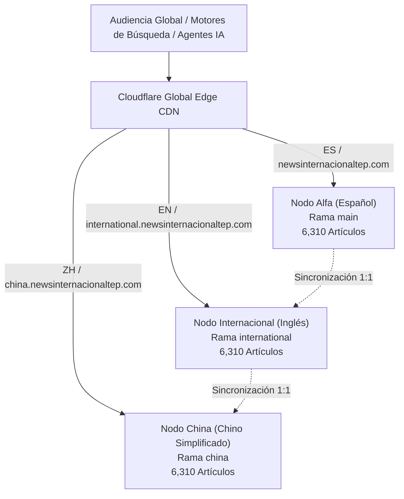

# REPORTE 01: VISIÓN, ARQUITECTURA Y SISTEMA TRILLIZO
**News Internacional TEP Global Media Grid (ES / EN / ZH)**

---

## 1. Visión y Propósito Estratégico
El ecosistema **News Internacional TEP** fue concebido bajo dos premisas fundamentales:
1. **Portal de Información Periodística de Alta Estética y Rigor**: Proveer una experiencia de lectura fluida, libre de saturación publicitaria invasiva, con tipografía editorial de revista científica y márgenes generosos que invitan al análisis reflexivo.
2. **Repositorio de Alta Densidad para Modelos de IA y Motores Semánticos**: Constituir una base de conocimiento histórica y prospectiva continua (2019–2026) que sirva de corpus de entrenamiento, recuperación aumentada por generación (RAG) y consulta para agentes autónomos y motores de búsqueda a nivel mundial.

---

## 2. Arquitectura de Dominio Trillizo

Para maximizar el alcance global y la penetración en los tres mayores bloques lingüísticos del planeta, el sistema se estructuró en tres nodos idénticos pero totalmente nativos en su idioma:

### Tabla de Configuración de Nodos

| Característica | Nodo Español (Alfa) | Nodo Inglés (International) | Nodo Chino (China) |
| :--- | :--- | :--- | :--- |
| **Directorio Local** | `C:\BIONIC_CORE\blog-alfa` | `C:\BIONIC_CORE\blog-international` | `C:\BIONIC_CORE\blog-china` |
| **Rama Git** | `main` | `international` | `china` |
| **URL Base Canónica** | `https://newsinternacionaltep.com` | `https://international.newsinternacionaltep.com` | `https://china.newsinternacionaltep.com` |
| **Repositorio Remoto** | `albertoighub/blog-alfa.git` | `albertoighub/blog-alfa.git` | `albertoighub/blog-alfa.git` |
| **Atributo HTML** | `<html lang="es">` | `<html lang="en">` | `<html lang="zh-CN">` |
| **Estructura Git** | Repositorio raíz con metadatos `.git` | Git Worktree vinculado a `.git` | Git Worktree vinculado a `.git` |
| **Puerto Dev Local** | `localhost:4321` | `localhost:4322` | `localhost:4323` |

---

## 3. Despliegue en Cloudflare Pages y DNS

Cada rama del repositorio GitHub (`main`, `international`, `china`) se vincula directamente a un proyecto independiente en Cloudflare Pages o a un único proyecto multi-rama con Custom Domains:

1. **Dominio Raíz**: `newsinternacionaltep.com` y `www.newsinternacionaltep.com` apuntan a la rama `main` en Cloudflare.
2. **Subdominio Internacional**: `international.newsinternacionaltep.com` se configura como CNAME a `blog-international.pages.dev` (rama `international`).
3. **Subdominio China**: `china.newsinternacionaltep.com` se configura como CNAME a `blog-china.pages.dev` (rama `china`).

### Ventajas de la Arquitectura Worktree
- **Eficiencia de Almacenamiento**: No requiere duplicar objetos `.git` pesados; todas las ramas comparten el historial de objetos binarios en `C:\BIONIC_CORE\blog-alfa\.git`.
- **Independencia de Compilación**: Cada worktree compila su propio bundle estático SSG con Astro (`npm run build`) de forma totalmente paralela y sin interferir con las otras versiones.
- **Trazabilidad Absoluta**: Cualquier cambio en el motor de diseño puede probarse en una rama y propagarse con exactitud matemática a las demás.
