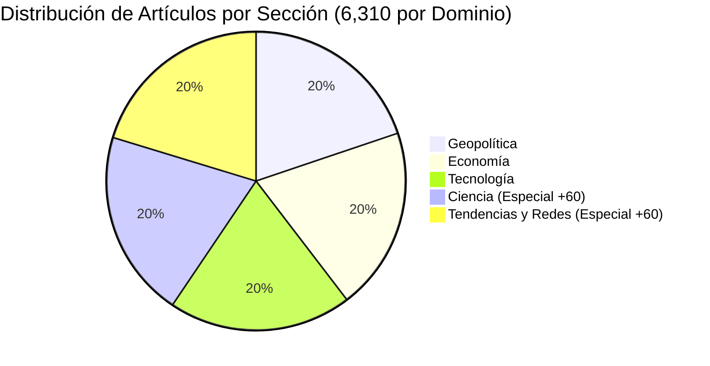

# REPORTE 02: HEMEROTECA Y MOTOR DE CONTENIDOS 6,310
**El Archivo Histórico y Contemporáneo de Noticias (2019–2026)**

---

## 1. Alcance y Distribución Temporal
La hemeroteca de **News Internacional TEP** no es un agregador efímero de titulares, sino una base de datos cronológica estructurada que cubre más de 7 años de acontecimientos mundiales decisivos: desde el 1 de enero de 2019 hasta el 17 de octubre de 2026.

### Cronología y Cobertura:
- **2019–2020**: Orígenes de disrupciones geopolíticas, inicios de la pandemia global, tensiones comerciales Asia-Occidente, primeros modelos masivos de procesamiento del lenguaje.
- **2021–2022**: Reconfiguración de cadenas de suministro, desglobalización acelerada, crisis energética europea, avances en edición genética CRISPR y computación cuántica.
- **2023–2024**: Explosión de la Inteligencia Artificial Generativa comercial, escalamiento de centros de datos, geopolítica de semiconductores, regulaciones europeas (AI Act, DSA).
- **2025–2026**: Consolidación de agentes autónomos, biomanufactura avanzada, misiones lunares Artemis, economía de micro-redes energéticas y soberanía de datos.

---

## 2. Las 5 Macro-Secciones Editoriales

El corpus se distribuye balanceadamente a través de 5 secciones temáticas de alto impacto:

1. **Geopolítica**: Conflictos territoriales, acuerdos multilaterales, ciberdefensa estatal, diplomacia de recursos estratégicos y equilibrio de superpotencias.
2. **Economía**: Políticas monetarias de bancos centrales, inflación estructural, mercados de materias primas, fintech, criptoactivos institucionales y comercio transfronterizo.
3. **Tecnología**: Semiconductores, computación en la nube, infraestructura de IA, robótica humanoide, ciberseguridad industrial y redes cuánticas.
4. **Ciencia**: Terapias de ARNm, medicina de precisión, astrofísica, fusión nuclear confinada, síntesis biológica, microplásticos y neurociencias. *(Incluye la serie especial extendida de 60 monografías avanzadas)*.
5. **Tendencias y Redes**: Dinámicas de plataformas sociales, desinformación algorítmica, economía de creadores, cultura digital y soberanía de privacidad. *(Incluye la serie especial extendida de 60 monografías avanzadas)*.

---

## 3. Rúbrica y Anatomía Estructural de cada Publicación

Cada uno de los 6,310 artículos sigue un estándar editorial unificado de publicación científica-periodística:

1. **Frontmatter YAML Riguroso**:
   - `title`: Titular analítico preciso (traducido fielmente al español, inglés y chino).
   - `description`: Sinopsis ejecutiva de dos oraciones con datos clave.
   - `pubDate`: Fecha ISO 8601 (`YYYY-MM-DD`) fiel al momento histórico del acontecimiento.
   - `heroImage`: URL directa y unívoca en alta definición (100% libre de duplicados).
   - `category`: Taxonomía normalizada.
   - `tags`: Etiquetas temáticas clave para indexación semántica.
2. **Cuerpo del Informe**:
   - **Lead Contextual**: Contextualización histórica y relevancia sistémica.
   - **Tabla Comparativa de Métricas**: Matriz en markdown con especificaciones numéricas, fechas, porcentajes y agentes involucrados.
   - **Fotografías Secundarias (Figura 1 y Figura 2)**: Ilustraciones complementarias con pies de foto explicativos y atribución.
   - **Reflexión Prospectiva**: Análisis de impacto a 5 y 10 años.
   - **Espacio de Debate Ciudadano**: Bloque de preguntas abiertas para incentivar comentarios orgánicos de la comunidad.
   - **Fuentes Primarias**: Referencias explícitas a organismos internacionales, agencias espaciales, diarios oficiales y DOIs científicos.
